# OrbisPM Database Schema — Design Document

> **Source:** generated from the running local PostgreSQL 16 database (`orbispmdev`) at migration **v28** on the `staging` branch (`a00dbe9`), checked on 2026-10-18. Migrations **29–31** exist only on `main` and are documented in [Pending on `main`](#pending-on-main-migrations-2931). The authoritative DDL is `backend/db/migrations/`; this document explains it.

**Audience:** engineers working on the OrbisPM API, messaging-service and analytics code.

## 1. At a glance

- **58 tables** in the `public` schema, **38** with row-level security, **79** foreign keys, **174** indexes, **9 triggers** (counted per event).
- **One shared database** for the API (Go, `backend/`) and messaging-service; both reach it through PgBouncer in session mode.
- **Extensions:** `pgcrypto` (random UUIDs, hashing), `pg_trgm` (fuzzy search indexes), `pg_stat_statements` (query stats).
- **Migrations:** golang-migrate, files `backend/db/migrations/NNNNNN_name.{up,down}.sql`, applied by `/app/migrate up` before the API starts. messaging-service tracks its own tables in `messaging_schema_migrations`.

## 2. Design principles

1. **Multi-tenancy by `org_id` plus RLS.** Almost every business table has `org_id uuid NOT NULL REFERENCES orgs(id)`. RLS is enabled on those tables with one policy shape:
   ```sql
   USING (org_id = current_setting('app.current_org_id', true)::uuid)
   ```
   The API must run `set_config('app.current_org_id', <org>, ...)` on the connection before touching tenant data, which is why PgBouncer runs in **session** mode. Tables linked to a tenant only through a parent (for example `announcement_reads`, `role_permissions`) use a sub-select policy instead.
2. **Tables without `org_id`** fall in three groups: *global* (`orgs`, `users`, `permissions`, `channel_permissions`, `billing_plans`, `contact_submissions`, `schema_migrations`, `messaging_schema_migrations`); *user-owned* (`sticky_notes`, `user_backup_codes`); and *child or junction tables* that inherit tenancy from a parent (`org_members` is the exception, it carries `org_id`; `team_members`, `project_members`, `project_teams`, `role_permissions`, `task_dependencies`, `task_watchers`, `announcement_reads`, `channel_members`, `channel_role_permissions`, `message_reactions`, `message_bookmarks`, `pinned_messages`, `user_category_states`).
3. **Primary keys are `uuid`**, defaulting to `gen_random_uuid()`, except junction tables (composite keys) and `users.id`, which is derived from the identity provider (see §4.1).
4. **Timestamps are `timestamptz`.** `updated_at` is maintained by the `update_updated_at()` trigger on `comments`, `org_subscriptions`, `orgs`, `projects`, `task_templates`, `tasks` and `teams`; other tables that have the column (for example `channels`, `messages`, `users`) rely on application code to set it.
5. **Enumerations are `text` plus `CHECK`**, not PostgreSQL enums, so adding a value is a one-line migration. (The only PG enum, `river_job_state`, belongs to the River job-queue tables in the separate `queue` schema, which this document does not cover.)
6. **JSONB for open-ended payloads** (`settings`, `metadata`, `changes`, `metrics`, `factors`), relational columns for anything filtered or joined.
7. **Versioned tasks:** `tasks.version` is bumped by trigger `trg_tasks_version` on every update. `task_service` compares the client's `BaseVersion` with the stored version to detect conflicting edits.
8. **Tenant deletion cascades:** foreign keys to `orgs` are `ON DELETE CASCADE` for owned data, so removing an org removes its data.

## 3. Domain map

Edges to `orgs` and `users` are omitted — nearly every table has them — so the diagram shows only the relationships between the other tables.

```mermaid
erDiagram
    announcements ||--o{ announcement_reads : "announcement_id"
    projects ||--o{ announcements : "project_id"
    task_change_requests ||--o{ attachments : "change_request_id"
    comments ||--o{ attachments : "comment_id"
    tasks ||--o{ attachments : "task_id"
    channels ||--o{ channel_members : "channel_id"
    channel_permissions ||--o{ channel_role_permissions : "permission_id"
    channel_categories ||--o{ channels : "category_id"
    tasks ||--o{ checklists : "task_id"
    comments ||--o{ comments : "parent_id"
    tasks ||--o{ comments : "task_id"
    projects ||--o{ import_jobs : "project_id"
    messages ||--o{ message_attachments : "message_id"
    messages ||--o{ message_bookmarks : "message_id"
    messages ||--o{ message_reactions : "message_id"
    channels ||--o{ messages : "channel_id"
    messages ||--o{ messages : "forwarded_from_id"
    messages ||--o{ messages : "parent_message_id"
    billing_plans ||--o{ org_subscriptions : "plan_id"
    channels ||--o{ pinned_messages : "channel_id"
    messages ||--o{ pinned_messages : "message_id"
    projects ||--o{ project_members : "project_id"
    teams ||--o{ project_members : "source_team_id"
    projects ||--o{ project_teams : "project_id"
    teams ||--o{ project_teams : "team_id"
    teams ||--o{ projects : "team_id"
    tasks ||--o{ risk_scores : "task_id"
    permissions ||--o{ role_permissions : "permission_id"
    roles ||--o{ role_permissions : "role_id"
    channels ||--o{ scheduled_messages : "channel_id"
    messages ||--o{ scheduled_messages : "parent_message_id"
    tasks ||--o{ task_change_requests : "task_id"
    tasks ||--o{ task_dependencies : "depends_on_id"
    tasks ||--o{ task_dependencies : "task_id"
    tasks ||--o{ task_rules : "task_id"
    tasks ||--o{ task_state_transitions : "task_id"
    projects ||--o{ task_status_snapshots : "project_id"
    tasks ||--o{ task_watchers : "task_id"
    tasks ||--o{ tasks : "parent_task_id"
    projects ||--o{ tasks : "project_id"
    tasks ||--o{ tasks : "recurrence_parent_id"
    teams ||--o{ team_manager_history : "team_id"
    teams ||--o{ team_members : "team_id"
    channel_categories ||--o{ user_category_states : "category_id"
```



| Domain | Tables |
|---|---|
| [Identity & Tenancy](#identity--tenancy) — Who the users are and which organisation (tenant) they belong to. | `orgs`, `users`, `org_members`, `org_theme_configs`, `api_keys`, `user_backup_codes`, `notification_preferences`, `sticky_notes` |
| [Teams & Projects](#teams--projects) — How people are grouped (teams) and what they work on (projects). | `teams`, `team_members`, `team_manager_history`, `projects`, `project_members`, `project_teams` |
| [RBAC](#rbac) — Roles and permissions at org, team and project scope. | `roles`, `permissions`, `role_permissions`, `custom_roles` |
| [Tasks & Collaboration](#tasks--collaboration) — The work items and everything attached to them. | `tasks`, `task_dependencies`, `task_watchers`, `task_templates`, `task_rules`, `task_change_requests`, `task_state_transitions`, `task_status_snapshots`, `checklists`, `comments`, `attachments`, `activity_log`, `import_jobs` |
| [Messaging](#messaging) — Channels, DMs and messages (shared database, owned by messaging-service at runtime). | `channels`, `channel_members`, `channel_categories`, `user_category_states`, `channel_permissions`, `channel_role_permissions`, `messages`, `message_attachments`, `message_reactions`, `message_bookmarks`, `pinned_messages`, `scheduled_messages` |
| [Notifications & Announcements](#notifications--announcements) — In-app notifications and org-wide announcements. | `notifications`, `announcements`, `announcement_reads` |
| [Analytics & Performance](#analytics--performance) — Event capture, rolled-up metrics, risk scoring and generated reports. | `analytics_events`, `daily_metrics`, `weekly_metrics`, `metric_alerts`, `risk_scores`, `performance_reports` |
| [Billing & Public](#billing--public) — Plans, subscriptions, outbound webhooks and the public contact form. | `billing_plans`, `org_subscriptions`, `webhooks`, `contact_submissions` |
| [Migration Bookkeeping](#migration-bookkeeping) — Tables that track applied migrations. | `schema_migrations`, `messaging_schema_migrations` |

## 4. Cross-cutting design notes

### 4.1 Identity: how `users.id` is formed

On this branch the auth middleware computes `users.id = uuid5(NAMESPACE_URL, <Zitadel subject>)` on every request, and that UUID is stored in `org_members.user_id`, `team_members.user_id`, `project_members.user_id`, `tasks.assignee_id`/`reporter_id` and similar columns. These are **logical references only**: the database declares just 5 foreign keys to `users` (see Observations), so integrity is enforced by application code. This only works while one Zitadel instance keeps issuing the same subjects. `main` fixes this with migration 000029 (`users.zitadel_user_id`), described in the last section.

### 4.2 RBAC: scopes, roles, permissions

- `permissions` is a global catalogue of `(scope, resource, action)` where `scope ∈ {org, team, project}`.
- `roles` is per org (`org_id`, `scope`, `slug`); `role_permissions` grants permissions to roles. `UNIQUE (org_id, scope, slug)` keeps the seed idempotent.
- Trigger `trg_seed_org_roles` on `orgs` calls `seed_org_roles(org_id)` so every new org gets its system roles (`is_system = true`): org-scope Owner, Admin, Member, Viewer, Billing Admin; team-scope Team Lead, Member and Viewer; project-scope Project Lead, Contributor, Reviewer and Observer.
- Membership tables carry the role: `org_members.role`, `team_members.role`, `project_members.role`. A user's effective rights on a task come from their **project** role, not just the org role.
- `custom_roles` lets an org define extra roles with a JSON permission list.
- Channel permissions are a separate, simpler model: `channel_members.role ∈ {owner, admin, moderator, member, viewer}` mapped through `channel_role_permissions` to `channel_permissions`.

### 4.3 Task hierarchy

`tasks.parent_task_id` references `tasks(id)`; `depth` is stored and constrained to `0..3`, so the tree is at most four levels deep and subtree queries never need unbounded recursion. `position` orders siblings. `assignee_ids uuid[]` holds all assignees; `assignee_id` is kept alongside it and both are selected by the task repository. Recurring tasks use `recurrence_rule` (RFC 5545 RRULE), `recurrence_parent_id` and `next_occurrence`.

### 4.4 Direct messages

`get_or_create_dm_channel(org, user_a, user_b)` builds a canonical `dm_pair` key (the two UUIDs, sorted, joined by `:`), returns the existing DM channel if there is one, otherwise creates it and both `channel_members` rows. A DM with yourself raises `check_violation`.

### 4.5 Analytics pipeline

Events are written to `analytics_events` (`analytics_repo.go`); status changes to `task_state_transitions` (`analytics_repo.go` and the background worker); the worker also writes daily `task_status_snapshots`. `analytics_repo.go` upserts `daily_metrics` and `weekly_metrics`. `risk_scores` and `metric_alerts` hold derived results. `performance_reports` tracks asynchronous report generation, with the output location in `storage_path`.

## Identity & Tenancy

Who the users are and which organisation (tenant) they belong to.

### `orgs`

Tenant root. Every tenant-owned row carries an `org_id` that points here.

| Column | Type | Null | Default |
|---|---|---|---|
| `id` | uuid | no | `gen_random_uuid()` |
| `name` | text | no |  |
| `slug` | text | no |  |
| `logo_url` | text | yes |  |
| `plan` | text | no | `'free'` |
| `billing_customer_id` | text | yes |  |
| `settings` | jsonb | no | `'{}'` |
| `created_at` | timestamptz | no | `now()` |
| `updated_at` | timestamptz | no | `now()` |

- **Primary key:** `(id)`
- **Unique:** `(slug)`

<details><summary>Indexes (1)</summary>

- `orgs_slug_key` — `UNIQUE USING btree (slug)`

</details>

### `users`

Application user profile, one row per Zitadel identity. On this branch `id = uuid5(NAMESPACE_URL, <Zitadel subject>)`, computed by the auth middleware. Not tenant-scoped: a user can belong to several orgs.

| Column | Type | Null | Default |
|---|---|---|---|
| `id` | uuid | no |  |
| `email` | text | no | `''` |
| `display_name` | text | no | `''` |
| `phone` | text | no | `''` |
| `avatar_url` | text | no | `''` |
| `created_at` | timestamptz | no | `now()` |
| `updated_at` | timestamptz | no | `now()` |
| `bio` | text | no | `''` |
| `job_title` | text | no | `''` |
| `department` | text | no | `''` |
| `timezone` | text | no | `''` |
| `language` | text | no | `''` |
| `theme` | text | no | `'orbis-light'` |
| `theme_customisation` | jsonb | yes |  |

- **Primary key:** `(id)`

<details><summary>Indexes (1)</summary>

- `idx_users_email` — `USING btree (email)`

</details>

### `org_members`

Membership of a user in an org, with the org-scope role.

| Column | Type | Null | Default |
|---|---|---|---|
| `org_id` | uuid | no |  |
| `user_id` | uuid | no |  |
| `role` | text | no | `'member'` |
| `joined_at` | timestamptz | no | `now()` |

- **Primary key:** `(org_id, user_id)`
- **FK:** `org_id` → `orgs(id)` ON DELETE CASCADE
- **RLS** `tenant_isolation_org_members` (ALL): `(org_id = (current_setting('app.current_org_id'::text, true))::uuid)`

<details><summary>Indexes (2)</summary>

- `idx_org_members_org_user` — `USING btree (org_id, user_id)`
- `idx_org_members_user` — `USING btree (user_id)`

</details>

### `org_theme_configs`

Per-org UI theme (base theme, custom colours, lock flag).

| Column | Type | Null | Default |
|---|---|---|---|
| `org_id` | uuid | no |  |
| `base_theme` | text | no | `'orbis-light'` |
| `custom_colors` | jsonb | no | `'{}'` |
| `locked` | bool | no | `false` |
| `updated_at` | timestamptz | no | `now()` |
| `updated_by` | uuid | yes |  |

- **Primary key:** `(org_id)`
- **FK:** `org_id` → `orgs(id)` ON DELETE CASCADE

### `api_keys`

Hashed API keys for programmatic access; only the hash and a display prefix are stored.

| Column | Type | Null | Default |
|---|---|---|---|
| `id` | uuid | no | `gen_random_uuid()` |
| `org_id` | uuid | no |  |
| `user_id` | uuid | no |  |
| `name` | text | no |  |
| `key_hash` | text | no |  |
| `key_prefix` | text | no |  |
| `scopes` | text[] | no | `'{}'` |
| `last_used_at` | timestamptz | yes |  |
| `expires_at` | timestamptz | yes |  |
| `created_at` | timestamptz | no | `now()` |

- **Primary key:** `(id)`
- **FK:** `org_id` → `orgs(id)` ON DELETE CASCADE
- **RLS** `tenant_isolation_api_keys` (ALL): `(org_id = (current_setting('app.current_org_id'::text, true))::uuid)`

<details><summary>Indexes (2)</summary>

- `idx_api_keys_hash` — `USING btree (key_hash)`
- `idx_api_keys_org` — `USING btree (org_id)`

</details>

### `user_backup_codes`

Hashed MFA backup codes per user.

| Column | Type | Null | Default |
|---|---|---|---|
| `id` | uuid | no | `gen_random_uuid()` |
| `user_id` | uuid | no |  |
| `code_hash` | text | no |  |
| `created_at` | timestamptz | no | `now()` |

- **Primary key:** `(id)`
- **FK:** `user_id` → `users(id)` ON DELETE CASCADE

<details><summary>Indexes (1)</summary>

- `idx_user_backup_codes_user` — `USING btree (user_id)`

</details>

### `notification_preferences`

Per-user, per-org switches for each notification event type and delivery channel.

| Column | Type | Null | Default |
|---|---|---|---|
| `id` | uuid | no | `gen_random_uuid()` |
| `user_id` | uuid | no |  |
| `org_id` | uuid | no |  |
| `event_type` | text | no |  |
| `channel` | text | no |  |
| `enabled` | bool | no | `true` |

- **Primary key:** `(id)`
- **FK:** `org_id` → `orgs(id)` ON DELETE CASCADE
- **Unique:** `(user_id, org_id, event_type, channel)`

<details><summary>Indexes (1)</summary>

- `notification_preferences_user_id_org_id_event_type_channel_key` — `UNIQUE USING btree (user_id, org_id, event_type, channel)`

</details>

### `sticky_notes`

Personal sticky notes with optional dates and a JSON checklist. Owned by a user, not an org.

| Column | Type | Null | Default |
|---|---|---|---|
| `id` | uuid | no | `gen_random_uuid()` |
| `user_id` | uuid | no |  |
| `title` | varchar(255) | no |  |
| `description` | text | no | `''` |
| `color` | varchar(20) | no | `'yellow'` |
| `priority` | varchar(10) | no | `'medium'` |
| `start_date` | timestamptz | yes |  |
| `due_date` | timestamptz | yes |  |
| `completed` | bool | no | `false` |
| `checkpoints` | jsonb | no | `'[]'` |
| `created_at` | timestamptz | no | `now()` |
| `updated_at` | timestamptz | no | `now()` |

- **Primary key:** `(id)`
- **Check:** `((priority)::text = ANY ((ARRAY['low'::character varying, 'medium'::character varying, 'high'::character varying, 'urgent'::character varying])::text[]))`

<details><summary>Indexes (3)</summary>

- `idx_sticky_notes_user_completed` — `USING btree (user_id, completed)`
- `idx_sticky_notes_user_due` — `USING btree (user_id, due_date)`
- `idx_sticky_notes_user_id` — `USING btree (user_id)`

</details>

## Teams & Projects

How people are grouped (teams) and what they work on (projects).

### `teams`

Groups of users inside an org. Can be auto-created from a department or a project (`auto_source`).

| Column | Type | Null | Default |
|---|---|---|---|
| `id` | uuid | no | `gen_random_uuid()` |
| `org_id` | uuid | no |  |
| `name` | text | no |  |
| `description` | text | yes |  |
| `created_at` | timestamptz | no | `now()` |
| `updated_at` | timestamptz | no | `now()` |
| `manager_id` | uuid | yes |  |
| `is_auto_managed` | bool | no | `false` |
| `auto_source` | text | yes |  |
| `auto_source_id` | text | yes |  |
| `status` | text | no | `'active'` |

- **Primary key:** `(id)`
- **FK:** `manager_id` → `users(id)` ON DELETE SET NULL
- **FK:** `org_id` → `orgs(id)` ON DELETE CASCADE
- **Check:** `(auto_source = ANY (ARRAY['department'::text, 'project'::text, 'manual'::text]))`
- **RLS** `tenant_isolation_teams` (ALL): `(org_id = (current_setting('app.current_org_id'::text, true))::uuid)`

<details><summary>Indexes (4)</summary>

- `idx_teams_auto_source` — `USING btree (org_id, auto_source, auto_source_id) WHERE (is_auto_managed = true)`
- `idx_teams_manager` — `USING btree (manager_id) WHERE (manager_id IS NOT NULL)`
- `idx_teams_org` — `USING btree (org_id)`
- `idx_teams_status` — `USING btree (status)`

</details>

### `team_members`

Membership of a user in a team, with the team-scope role.

| Column | Type | Null | Default |
|---|---|---|---|
| `team_id` | uuid | no |  |
| `user_id` | uuid | no |  |
| `role` | text | no | `'member'` |
| `joined_at` | timestamptz | no | `now()` |

- **Primary key:** `(team_id, user_id)`
- **FK:** `team_id` → `teams(id)` ON DELETE CASCADE
- **RLS** `tenant_isolation_team_members` (ALL): `(team_id IN ( SELECT teams.id FROM teams WHERE (teams.org_id = (current_setting('app.current_org_id'::text, true))::uuid)))`

<details><summary>Indexes (2)</summary>

- `idx_team_members_team` — `USING btree (team_id)`
- `idx_team_members_user` — `USING btree (user_id)`

</details>

### `team_manager_history`

Audit trail of team manager changes (who, from whom, to whom, why).

| Column | Type | Null | Default |
|---|---|---|---|
| `id` | uuid | no | `gen_random_uuid()` |
| `team_id` | uuid | no |  |
| `org_id` | uuid | no |  |
| `previous_manager_id` | uuid | yes |  |
| `new_manager_id` | uuid | yes |  |
| `changed_by` | uuid | no |  |
| `reason` | text | yes |  |
| `changed_at` | timestamptz | no | `now()` |

- **Primary key:** `(id)`
- **FK:** `changed_by` → `users(id)` ON DELETE SET NULL
- **FK:** `new_manager_id` → `users(id)` ON DELETE SET NULL
- **FK:** `org_id` → `orgs(id)` ON DELETE CASCADE
- **FK:** `previous_manager_id` → `users(id)` ON DELETE SET NULL
- **FK:** `team_id` → `teams(id)` ON DELETE CASCADE
- **RLS** `team_manager_history_org_isolation` (ALL): `(org_id = (current_setting('app.current_org_id'::text))::uuid)`

<details><summary>Indexes (1)</summary>

- `idx_team_manager_history_team` — `USING btree (team_id)`

</details>

### `projects`

A project inside an org; parent of tasks, canvases and project channels.

| Column | Type | Null | Default |
|---|---|---|---|
| `id` | uuid | no | `gen_random_uuid()` |
| `org_id` | uuid | no |  |
| `team_id` | uuid | yes |  |
| `name` | text | no |  |
| `description` | text | yes |  |
| `status` | text | no | `'active'` |
| `settings` | jsonb | no | `'{}'` |
| `created_at` | timestamptz | no | `now()` |
| `updated_at` | timestamptz | no | `now()` |
| `created_by` | uuid | yes |  |

- **Primary key:** `(id)`
- **FK:** `org_id` → `orgs(id)` ON DELETE CASCADE
- **FK:** `team_id` → `teams(id)` ON DELETE CASCADE
- **RLS** `tenant_isolation_projects` (ALL): `(org_id = (current_setting('app.current_org_id'::text, true))::uuid)`

<details><summary>Indexes (2)</summary>

- `idx_projects_org` — `USING btree (org_id)`
- `idx_projects_team` — `USING btree (team_id)`

</details>

### `project_members`

Membership of a user in a project with the project-scope role; `source` is `direct` (added to the project) or `team` (inherited through a team in `project_teams`).

| Column | Type | Null | Default |
|---|---|---|---|
| `project_id` | uuid | no |  |
| `user_id` | uuid | no |  |
| `role` | text | no | `'contributor'` |
| `joined_at` | timestamptz | no | `now()` |
| `source` | text | no | `'direct'` |
| `source_team_id` | uuid | yes |  |

- **Primary key:** `(project_id, user_id)`
- **FK:** `project_id` → `projects(id)` ON DELETE CASCADE
- **FK:** `source_team_id` → `teams(id)` ON DELETE SET NULL
- **RLS** `tenant_isolation_project_members` (ALL): `(project_id IN ( SELECT projects.id FROM projects WHERE (projects.org_id = (current_setting('app.current_org_id'::text, true))::uuid)))`

<details><summary>Indexes (3)</summary>

- `idx_project_members_project` — `USING btree (project_id)`
- `idx_project_members_source_team` — `USING btree (source_team_id)`
- `idx_project_members_user` — `USING btree (user_id)`

</details>

### `project_teams`

Many-to-many link between projects and teams.

| Column | Type | Null | Default |
|---|---|---|---|
| `project_id` | uuid | no |  |
| `team_id` | uuid | no |  |
| `added_at` | timestamptz | no | `now()` |

- **Primary key:** `(project_id, team_id)`
- **FK:** `project_id` → `projects(id)` ON DELETE CASCADE
- **FK:** `team_id` → `teams(id)` ON DELETE CASCADE
- **RLS** `tenant_isolation_project_teams` (ALL): `(project_id IN ( SELECT projects.id FROM projects WHERE (projects.org_id = (current_setting('app.current_org_id'::text, true))::uuid)))`

<details><summary>Indexes (2)</summary>

- `idx_project_teams_project` — `USING btree (project_id)`
- `idx_project_teams_team` — `USING btree (team_id)`

</details>

## RBAC

Roles and permissions at org, team and project scope.

### `roles`

Role definitions per org and scope (`org`, `team`, `project`). System roles are seeded for every new org by `seed_org_roles`.

| Column | Type | Null | Default |
|---|---|---|---|
| `id` | uuid | no | `gen_random_uuid()` |
| `org_id` | uuid | no |  |
| `scope` | text | no |  |
| `slug` | text | no |  |
| `name` | text | no |  |
| `description` | text | yes |  |
| `is_system` | bool | no | `false` |
| `created_at` | timestamptz | no | `now()` |

- **Primary key:** `(id)`
- **FK:** `org_id` → `orgs(id)` ON DELETE CASCADE
- **Check:** `(scope = ANY (ARRAY['org'::text, 'team'::text, 'project'::text]))`
- **Unique:** `(org_id, scope, slug)`
- **RLS** `tenant_isolation_roles` (ALL): `(org_id = (current_setting('app.current_org_id'::text, true))::uuid)`

<details><summary>Indexes (3)</summary>

- `idx_roles_org` — `USING btree (org_id)`
- `idx_roles_org_scope` — `USING btree (org_id, scope)`
- `roles_org_id_scope_slug_key` — `UNIQUE USING btree (org_id, scope, slug)`

</details>

### `permissions`

Global catalogue of permissions as (scope, resource, action). Not tenant-scoped.

| Column | Type | Null | Default |
|---|---|---|---|
| `id` | uuid | no | `gen_random_uuid()` |
| `resource` | text | no |  |
| `action` | text | no |  |
| `scope` | text | no | `'org'` |
| `description` | text | yes |  |

- **Primary key:** `(id)`
- **Check:** `(scope = ANY (ARRAY['org'::text, 'team'::text, 'project'::text]))`
- **Unique:** `(resource, action, scope)`

<details><summary>Indexes (2)</summary>

- `idx_permissions_resource` — `USING btree (resource, action)`
- `permissions_resource_action_scope_key` — `UNIQUE USING btree (resource, action, scope)`

</details>

### `role_permissions`

Many-to-many grant of permissions to roles.

| Column | Type | Null | Default |
|---|---|---|---|
| `role_id` | uuid | no |  |
| `permission_id` | uuid | no |  |

- **Primary key:** `(role_id, permission_id)`
- **FK:** `permission_id` → `permissions(id)` ON DELETE CASCADE
- **FK:** `role_id` → `roles(id)` ON DELETE CASCADE
- **RLS** `tenant_isolation_role_permissions` (ALL): `(role_id IN ( SELECT roles.id FROM roles WHERE (roles.org_id = (current_setting('app.current_org_id'::text, true))::uuid)))`

<details><summary>Indexes (1)</summary>

- `idx_role_permissions_perm` — `USING btree (permission_id)`

</details>

### `custom_roles`

Org-defined roles whose permission set is stored as JSON.

| Column | Type | Null | Default |
|---|---|---|---|
| `id` | uuid | no | `gen_random_uuid()` |
| `org_id` | uuid | no |  |
| `name` | text | no |  |
| `description` | text | yes |  |
| `permissions` | jsonb | no |  |
| `created_at` | timestamptz | no | `now()` |

- **Primary key:** `(id)`
- **FK:** `org_id` → `orgs(id)` ON DELETE CASCADE
- **Unique:** `(org_id, name)`
- **RLS** `tenant_isolation_custom_roles` (ALL): `(org_id = (current_setting('app.current_org_id'::text, true))::uuid)`

<details><summary>Indexes (1)</summary>

- `custom_roles_org_id_name_key` — `UNIQUE USING btree (org_id, name)`

</details>

## Tasks & Collaboration

The work items and everything attached to them.

### `tasks`

The central work item. Self-referencing hierarchy up to depth 3, a `version` counter, optional RFC 5545 recurrence, multiple assignees.

| Column | Type | Null | Default |
|---|---|---|---|
| `id` | uuid | no | `gen_random_uuid()` |
| `org_id` | uuid | no |  |
| `project_id` | uuid | no |  |
| `parent_task_id` | uuid | yes |  |
| `title` | text | no |  |
| `description` | text | yes |  |
| `status` | text | no | `'todo'` |
| `priority` | text | no | `'medium'` |
| `assignee_id` | uuid | yes |  |
| `reporter_id` | uuid | yes |  |
| `depth` | int4 | no | `0` |
| `position` | int4 | no | `0` |
| `due_date` | timestamptz | yes |  |
| `start_date` | timestamptz | yes |  |
| `estimated_hours` | numeric | yes |  |
| `actual_hours` | numeric | yes |  |
| `labels` | text[] | yes | `'{}'` |
| `metadata` | jsonb | no | `'{}'` |
| `review_status` | text | yes |  |
| `created_at` | timestamptz | no | `now()` |
| `updated_at` | timestamptz | no | `now()` |
| `recurrence_rule` — RFC 5545 RRULE string for recurring tasks | text | yes |  |
| `recurrence_parent_id` — Reference to the original recurring task template | uuid | yes |  |
| `next_occurrence` — Next scheduled occurrence date for recurring tasks | timestamptz | yes |  |
| `version` | int8 | no | `1` |
| `assignee_ids` | uuid[] | no | `'{}'` |

- **Primary key:** `(id)`
- **FK:** `org_id` → `orgs(id)` ON DELETE CASCADE
- **FK:** `parent_task_id` → `tasks(id)` ON DELETE CASCADE
- **FK:** `project_id` → `projects(id)` ON DELETE CASCADE
- **FK:** `recurrence_parent_id` → `tasks(id)` ON DELETE SET NULL
- **Check:** `((depth >= 0) AND (depth <= 3))`
- **RLS** `tenant_isolation_tasks` (ALL): `(org_id = (current_setting('app.current_org_id'::text, true))::uuid)`

<details><summary>Indexes (16)</summary>

- `idx_tasks_assignee` — `USING btree (org_id, assignee_id)`
- `idx_tasks_assignee_ids` — `USING gin (assignee_ids)`
- `idx_tasks_assignee_ids_gin` — `USING gin (assignee_ids)`
- `idx_tasks_due_date` — `USING btree (org_id, due_date) WHERE (due_date IS NOT NULL)`
- `idx_tasks_labels` — `USING gin (labels)`
- `idx_tasks_metadata` — `USING gin (metadata)`
- `idx_tasks_next_occurrence` — `USING btree (next_occurrence) WHERE (next_occurrence IS NOT NULL)`
- `idx_tasks_org` — `USING btree (org_id)`
- `idx_tasks_org_assignee` — `USING btree (org_id, assignee_id) WHERE (assignee_id IS NOT NULL)`
- `idx_tasks_org_project_status` — `USING btree (org_id, project_id, status) INCLUDE (priority, due_date, assignee_id)`
- `idx_tasks_parent` — `USING btree (parent_task_id)`
- `idx_tasks_project` — `USING btree (org_id, project_id)`
- `idx_tasks_recurrence` — `USING btree (org_id) WHERE (recurrence_rule IS NOT NULL)`
- `idx_tasks_status` — `USING btree (org_id, project_id, status)`
- `idx_tasks_tree_covering` — `USING btree (project_id, depth, "position", created_at) INCLUDE (id, parent_task_id, title, status, priority, assignee_id, assignee_ids, due_date, labels, version)`
- `idx_tasks_updated` — `USING btree (org_id, updated_at DESC)`

</details>

### `task_dependencies`

Directed 'blocked by' edge between two tasks. A task cannot depend on itself.

| Column | Type | Null | Default |
|---|---|---|---|
| `task_id` | uuid | no |  |
| `depends_on_id` | uuid | no |  |
| `type` | text | no | `'blocked_by'` |

- **Primary key:** `(task_id, depends_on_id)`
- **FK:** `depends_on_id` → `tasks(id)` ON DELETE CASCADE
- **FK:** `task_id` → `tasks(id)` ON DELETE CASCADE
- **Check:** `(task_id <> depends_on_id)`

<details><summary>Indexes (1)</summary>

- `idx_task_dependencies_depends_on` — `USING btree (depends_on_id)`

</details>

### `task_watchers`

Users subscribed to a task's updates.

| Column | Type | Null | Default |
|---|---|---|---|
| `task_id` | uuid | no |  |
| `user_id` | uuid | no |  |

- **Primary key:** `(task_id, user_id)`
- **FK:** `task_id` → `tasks(id)` ON DELETE CASCADE

<details><summary>Indexes (1)</summary>

- `idx_task_watchers_user` — `USING btree (user_id)`

</details>

### `task_templates`

Reusable task blueprints.

| Column | Type | Null | Default |
|---|---|---|---|
| `id` | uuid | no | `gen_random_uuid()` |
| `org_id` | uuid | no |  |
| `name` | text | no |  |
| `description` | text | yes |  |
| `structure` | jsonb | no |  |
| `is_shared` | bool | no | `false` |
| `created_by` | uuid | no |  |
| `created_at` | timestamptz | no | `now()` |
| `updated_at` | timestamptz | no | `now()` |

- **Primary key:** `(id)`
- **FK:** `org_id` → `orgs(id)` ON DELETE CASCADE
- **RLS** `tenant_isolation_templates` (ALL): `(org_id = (current_setting('app.current_org_id'::text, true))::uuid)`

<details><summary>Indexes (1)</summary>

- `idx_templates_org` — `USING btree (org_id)`

</details>

### `task_rules`

Per-task rules (type plus JSON config) that can be marked required.

| Column | Type | Null | Default |
|---|---|---|---|
| `id` | uuid | no | `gen_random_uuid()` |
| `org_id` | uuid | no |  |
| `task_id` | uuid | no |  |
| `rule_type` | text | no |  |
| `rule_config` | jsonb | no | `'{}'` |
| `is_required` | bool | no | `true` |
| `created_at` | timestamptz | no | `now()` |

- **Primary key:** `(id)`
- **FK:** `org_id` → `orgs(id)` ON DELETE CASCADE
- **FK:** `task_id` → `tasks(id)` ON DELETE CASCADE
- **RLS** `tenant_isolation_task_rules` (ALL): `(org_id = (current_setting('app.current_org_id'::text, true))::uuid)`

<details><summary>Indexes (1)</summary>

- `idx_task_rules_task` — `USING btree (task_id)`

</details>

### `task_change_requests`

Proposed edits to a task awaiting review (pending, approved, rejected), with the proposed changes as JSON.

| Column | Type | Null | Default |
|---|---|---|---|
| `id` | uuid | no | `gen_random_uuid()` |
| `org_id` | uuid | no |  |
| `task_id` | uuid | no |  |
| `proposer_id` | uuid | no |  |
| `reviewer_id` | uuid | yes |  |
| `status` | text | no | `'pending'` |
| `changes` | jsonb | no |  |
| `reason` | text | yes |  |
| `review_note` | text | yes |  |
| `created_at` | timestamptz | no | `now()` |
| `reviewed_at` | timestamptz | yes |  |

- **Primary key:** `(id)`
- **FK:** `org_id` → `orgs(id)` ON DELETE CASCADE
- **FK:** `task_id` → `tasks(id)` ON DELETE CASCADE
- **Check:** `(status = ANY (ARRAY['pending'::text, 'approved'::text, 'rejected'::text]))`
- **RLS** `tenant_isolation_change_requests` (ALL): `(org_id = (current_setting('app.current_org_id'::text, true))::uuid)`

<details><summary>Indexes (3)</summary>

- `idx_change_requests_org` — `USING btree (org_id, status)`
- `idx_change_requests_reviewer` — `USING btree (reviewer_id) WHERE (status = 'pending'::text)`
- `idx_change_requests_task` — `USING btree (task_id, status)`

</details>

### `task_state_transitions`

Append-only log of every status change on a task; feeds cycle-time analytics.

| Column | Type | Null | Default |
|---|---|---|---|
| `id` | uuid | no | `gen_random_uuid()` |
| `org_id` | uuid | no |  |
| `task_id` | uuid | no |  |
| `project_id` | uuid | no |  |
| `from_status` | text | yes |  |
| `to_status` | text | no |  |
| `actor_id` | uuid | no |  |
| `transitioned_at` | timestamptz | no | `now()` |

- **Primary key:** `(id)`
- **FK:** `org_id` → `orgs(id)` ON DELETE CASCADE
- **FK:** `task_id` → `tasks(id)` ON DELETE CASCADE
- **RLS** `task_state_transitions_isolation` (ALL): `(org_id = (current_setting('app.current_org_id'::text, true))::uuid)`

<details><summary>Indexes (3)</summary>

- `idx_task_transitions_project` — `USING btree (org_id, project_id, transitioned_at DESC)`
- `idx_task_transitions_status` — `USING btree (org_id, to_status, transitioned_at DESC)`
- `idx_task_transitions_task` — `USING btree (org_id, task_id, transitioned_at)`

</details>

### `task_status_snapshots`

Daily per-project counts of tasks by status, for burndown-style charts.

| Column | Type | Null | Default |
|---|---|---|---|
| `id` | uuid | no | `gen_random_uuid()` |
| `org_id` | uuid | no |  |
| `project_id` | uuid | no |  |
| `snapshot_date` | date | no |  |
| `todo_count` | int4 | no | `0` |
| `in_progress_count` | int4 | no | `0` |
| `blocked_count` | int4 | no | `0` |
| `done_count` | int4 | no | `0` |
| `total_count` | int4 | no | `0` |
| `created_at` | timestamptz | no | `now()` |

- **Primary key:** `(id)`
- **FK:** `org_id` → `orgs(id)` ON DELETE CASCADE
- **FK:** `project_id` → `projects(id)` ON DELETE CASCADE
- **Unique:** `(org_id, project_id, snapshot_date)`
- **RLS** `task_status_snapshots_isolation` (ALL): `(org_id = (current_setting('app.current_org_id'::text, true))::uuid)`

<details><summary>Indexes (2)</summary>

- `idx_task_snapshots_lookup` — `USING btree (org_id, project_id, snapshot_date DESC)`
- `task_status_snapshots_org_id_project_id_snapshot_date_key` — `UNIQUE USING btree (org_id, project_id, snapshot_date)`

</details>

### `checklists`

Checklist items under a task.

| Column | Type | Null | Default |
|---|---|---|---|
| `id` | uuid | no | `gen_random_uuid()` |
| `org_id` | uuid | no |  |
| `task_id` | uuid | no |  |
| `title` | text | no |  |
| `is_checked` | bool | no | `false` |
| `position` | int4 | no | `0` |
| `created_at` | timestamptz | no | `now()` |

- **Primary key:** `(id)`
- **FK:** `org_id` → `orgs(id)` ON DELETE CASCADE
- **FK:** `task_id` → `tasks(id)` ON DELETE CASCADE
- **RLS** `tenant_isolation_checklists` (ALL): `(org_id = (current_setting('app.current_org_id'::text, true))::uuid)`

<details><summary>Indexes (1)</summary>

- `idx_checklists_task` — `USING btree (task_id)`

</details>

### `comments`

Threaded comments on tasks.

| Column | Type | Null | Default |
|---|---|---|---|
| `id` | uuid | no | `gen_random_uuid()` |
| `org_id` | uuid | no |  |
| `task_id` | uuid | no |  |
| `user_id` | uuid | no |  |
| `body` | text | no |  |
| `parent_id` | uuid | yes |  |
| `created_at` | timestamptz | no | `now()` |
| `updated_at` | timestamptz | no | `now()` |

- **Primary key:** `(id)`
- **FK:** `org_id` → `orgs(id)` ON DELETE CASCADE
- **FK:** `parent_id` → `comments(id)` ON DELETE CASCADE
- **FK:** `task_id` → `tasks(id)` ON DELETE CASCADE
- **RLS** `tenant_isolation_comments` (ALL): `(org_id = (current_setting('app.current_org_id'::text, true))::uuid)`

<details><summary>Indexes (1)</summary>

- `idx_comments_task` — `USING btree (task_id)`

</details>

### `attachments`

File metadata for objects stored in MinIO.

| Column | Type | Null | Default |
|---|---|---|---|
| `id` | uuid | no | `gen_random_uuid()` |
| `org_id` | uuid | no |  |
| `task_id` | uuid | yes |  |
| `comment_id` | uuid | yes |  |
| `uploaded_by` | uuid | no |  |
| `filename` | text | no |  |
| `storage_path` | text | no |  |
| `file_size` | int8 | no |  |
| `mime_type` | text | no |  |
| `created_at` | timestamptz | no | `now()` |
| `change_request_id` | uuid | yes |  |

- **Primary key:** `(id)`
- **FK:** `change_request_id` → `task_change_requests(id)` ON DELETE CASCADE
- **FK:** `comment_id` → `comments(id)` ON DELETE CASCADE
- **FK:** `org_id` → `orgs(id)` ON DELETE CASCADE
- **FK:** `task_id` → `tasks(id)` ON DELETE CASCADE
- **RLS** `tenant_isolation_attachments` (ALL): `(org_id = (current_setting('app.current_org_id'::text, true))::uuid)`

<details><summary>Indexes (2)</summary>

- `idx_attachments_change_request_id` — `USING btree (change_request_id) WHERE (change_request_id IS NOT NULL)`
- `idx_attachments_task` — `USING btree (task_id)`

</details>

### `activity_log`

Generic audit feed: who did what to which entity, with a JSON diff.

| Column | Type | Null | Default |
|---|---|---|---|
| `id` | uuid | no | `gen_random_uuid()` |
| `org_id` | uuid | no |  |
| `entity_type` | text | no |  |
| `entity_id` | uuid | no |  |
| `action` | text | no |  |
| `actor_id` | uuid | no |  |
| `changes` | jsonb | yes |  |
| `metadata` | jsonb | yes | `'{}'` |
| `created_at` | timestamptz | no | `now()` |

- **Primary key:** `(id)`
- **FK:** `org_id` → `orgs(id)` ON DELETE CASCADE
- **RLS** `tenant_isolation_activity` (ALL): `(org_id = (current_setting('app.current_org_id'::text, true))::uuid)`

<details><summary>Indexes (3)</summary>

- `idx_activity_created` — `USING btree (org_id, created_at DESC)`
- `idx_activity_org_entity` — `USING btree (org_id, entity_type, entity_id)`
- `idx_activity_user` — `USING btree (org_id, actor_id, created_at DESC)`

</details>

### `import_jobs`

Bulk task import runs: file, column mapping, progress counters and errors.

| Column | Type | Null | Default |
|---|---|---|---|
| `id` | uuid | no | `gen_random_uuid()` |
| `org_id` | uuid | no |  |
| `project_id` | uuid | no |  |
| `user_id` | uuid | no |  |
| `status` | text | no | `'pending'` |
| `file_path` | text | no |  |
| `file_name` | text | no |  |
| `column_mapping` | jsonb | yes |  |
| `total_rows` | int4 | yes |  |
| `processed_rows` | int4 | yes | `0` |
| `error_rows` | int4 | yes | `0` |
| `errors` | jsonb | yes | `'[]'` |
| `result` | jsonb | yes | `'{}'` |
| `created_at` | timestamptz | no | `now()` |
| `completed_at` | timestamptz | yes |  |

- **Primary key:** `(id)`
- **FK:** `org_id` → `orgs(id)` ON DELETE CASCADE
- **FK:** `project_id` → `projects(id)` ON DELETE CASCADE
- **RLS** `tenant_isolation_import_jobs` (ALL): `(org_id = (current_setting('app.current_org_id'::text, true))::uuid)`

<details><summary>Indexes (1)</summary>

- `idx_import_jobs_project` — `USING btree (project_id)`

</details>

## Messaging

Channels, DMs and messages (shared database, owned by messaging-service at runtime).

### `channels`

Chat conversations: DM, group, team or project channel. DMs carry a canonical `dm_pair` key.

| Column | Type | Null | Default |
|---|---|---|---|
| `id` | uuid | no | `gen_random_uuid()` |
| `org_id` | uuid | no |  |
| `name` | text | no | `''` |
| `description` | text | no | `''` |
| `type` | text | no |  |
| `team_id` | uuid | yes |  |
| `project_id` | uuid | yes |  |
| `is_archived` | bool | no | `false` |
| `dm_pair` | text | yes |  |
| `avatar_url` | text | no | `''` |
| `created_by` | uuid | no |  |
| `created_at` | timestamptz | no | `now()` |
| `updated_at` | timestamptz | no | `now()` |
| `is_auto_managed` | bool | no | `false` |
| `auto_source` | text | yes |  |
| `auto_source_id` | uuid | yes |  |
| `read_only` | bool | no | `false` |
| `category_id` | uuid | yes |  |
| `position` | int4 | no | `0` |

- **Primary key:** `(id)`
- **FK:** `category_id` → `channel_categories(id)` ON DELETE SET NULL
- **Check:** `(auto_source = ANY (ARRAY['team'::text, 'project'::text]))`
- **Check:** `(type = ANY (ARRAY['dm'::text, 'group'::text, 'team'::text, 'project'::text]))`
- **RLS** `channels_org_isolation` (ALL): `((org_id)::text = current_setting('app.current_org_id'::text, true))`

<details><summary>Indexes (7)</summary>

- `idx_channels_auto_source` — `USING btree (auto_source, auto_source_id) WHERE (auto_source IS NOT NULL)`
- `idx_channels_category` — `USING btree (category_id, "position") WHERE (category_id IS NOT NULL)`
- `idx_channels_dm_pair` — `UNIQUE USING btree (org_id, dm_pair) WHERE ((type = 'dm'::text) AND (dm_pair IS NOT NULL))`
- `idx_channels_org_id` — `USING btree (org_id)`
- `idx_channels_org_type` — `USING btree (org_id, type)`
- `idx_channels_project` — `USING btree (project_id) WHERE (project_id IS NOT NULL)`
- `idx_channels_team` — `USING btree (team_id) WHERE (team_id IS NOT NULL)`

</details>

### `channel_members`

Membership and per-channel notification preference.

| Column | Type | Null | Default |
|---|---|---|---|
| `channel_id` | uuid | no |  |
| `user_id` | uuid | no |  |
| `role` | text | no | `'member'` |
| `last_read_at` | timestamptz | yes |  |
| `is_muted` | bool | no | `false` |
| `is_pinned` | bool | no | `false` |
| `joined_at` | timestamptz | no | `now()` |
| `notification_pref` | text | no | `'all'` |

- **Primary key:** `(channel_id, user_id)`
- **FK:** `channel_id` → `channels(id)` ON DELETE CASCADE
- **Check:** `(notification_pref = ANY (ARRAY['all'::text, 'mentions'::text, 'nothing'::text]))`
- **Check:** `(role = ANY (ARRAY['owner'::text, 'admin'::text, 'moderator'::text, 'member'::text, 'viewer'::text]))`

<details><summary>Indexes (3)</summary>

- `idx_channel_members_channel` — `USING btree (channel_id)`
- `idx_channel_members_channel_user` — `USING btree (channel_id, user_id)`
- `idx_channel_members_user` — `USING btree (user_id)`

</details>

### `channel_categories`

Sidebar groupings for channels, optionally auto-generated from teams or projects.

| Column | Type | Null | Default |
|---|---|---|---|
| `id` | uuid | no | `gen_random_uuid()` |
| `org_id` | uuid | no |  |
| `name` | text | no |  |
| `position` | int4 | no | `0` |
| `auto_source` | text | yes |  |
| `auto_source_id` | uuid | yes |  |
| `created_at` | timestamptz | no | `now()` |
| `updated_at` | timestamptz | no | `now()` |

- **Primary key:** `(id)`
- **Check:** `(auto_source = ANY (ARRAY['team'::text, 'project'::text]))`
- **RLS** `category_org_isolation` (ALL): `(org_id = (current_setting('app.current_org_id'::text))::uuid)`

<details><summary>Indexes (2)</summary>

- `idx_channel_categories_auto` — `USING btree (auto_source, auto_source_id) WHERE (auto_source IS NOT NULL)`
- `idx_channel_categories_org` — `USING btree (org_id, "position")`

</details>

### `user_category_states`

Per-user collapsed/expanded state for each channel category.

| Column | Type | Null | Default |
|---|---|---|---|
| `user_id` | uuid | no |  |
| `category_id` | uuid | no |  |
| `is_collapsed` | bool | no | `false` |

- **Primary key:** `(user_id, category_id)`
- **FK:** `category_id` → `channel_categories(id)` ON DELETE CASCADE

### `channel_permissions`

Catalogue of channel-level permissions (resource, action). Not tenant-scoped.

| Column | Type | Null | Default |
|---|---|---|---|
| `id` | uuid | no | `gen_random_uuid()` |
| `resource` | text | no |  |
| `action` | text | no |  |
| `description` | text | no | `''` |

- **Primary key:** `(id)`
- **Unique:** `(resource, action)`

<details><summary>Indexes (2)</summary>

- `channel_permissions_resource_action_key` — `UNIQUE USING btree (resource, action)`
- `idx_channel_permissions_resource_action` — `USING btree (resource, action)`

</details>

### `channel_role_permissions`

Which channel roles hold which channel permissions.

| Column | Type | Null | Default |
|---|---|---|---|
| `role` | text | no |  |
| `permission_id` | uuid | no |  |

- **Primary key:** `(role, permission_id)`
- **FK:** `permission_id` → `channel_permissions(id)` ON DELETE CASCADE
- **Check:** `(role = ANY (ARRAY['owner'::text, 'admin'::text, 'moderator'::text, 'member'::text, 'viewer'::text]))`

<details><summary>Indexes (1)</summary>

- `idx_channel_role_permissions_role` — `USING btree (role)`

</details>

### `messages`

Chat messages (text or markdown). Supports threads (`parent_message_id`, `thread_count`), forwarding (`forwarded_from_id`), soft delete, edit tracking, mentions and system messages (`is_system`, `system_type`).

| Column | Type | Null | Default |
|---|---|---|---|
| `id` | uuid | no | `gen_random_uuid()` |
| `org_id` | uuid | no |  |
| `channel_id` | uuid | no |  |
| `user_id` | uuid | no |  |
| `body` | text | no |  |
| `body_format` | text | no | `'text'` |
| `parent_message_id` | uuid | yes |  |
| `thread_count` | int4 | no | `0` |
| `forwarded_from_id` | uuid | yes |  |
| `mentions` | uuid[] | yes | `'{}'` |
| `is_deleted` | bool | no | `false` |
| `deleted_at` | timestamptz | yes |  |
| `is_edited` | bool | no | `false` |
| `edited_at` | timestamptz | yes |  |
| `created_at` | timestamptz | no | `now()` |
| `updated_at` | timestamptz | no | `now()` |
| `sender_name` | text | no | `''` |
| `entity_mentions` | jsonb | yes | `'[]'` |
| `is_system` | bool | no | `false` |
| `system_type` | text | yes |  |
| `system_metadata` | jsonb | yes | `'{}'` |

- **Primary key:** `(id)`
- **FK:** `channel_id` → `channels(id)` ON DELETE CASCADE
- **FK:** `forwarded_from_id` → `messages(id)` ON DELETE SET NULL
- **FK:** `parent_message_id` → `messages(id)` ON DELETE SET NULL
- **Check:** `(body_format = ANY (ARRAY['text'::text, 'markdown'::text]))`
- **RLS** `messages_org_isolation` (ALL): `((org_id)::text = current_setting('app.current_org_id'::text, true))`

<details><summary>Indexes (6)</summary>

- `idx_messages_body_trgm` — `USING gin (body gin_trgm_ops)`
- `idx_messages_channel_created` — `USING btree (channel_id, created_at DESC) WHERE ((parent_message_id IS NULL) AND (is_deleted = false))`
- `idx_messages_channel_time` — `USING btree (org_id, channel_id, created_at DESC)`
- `idx_messages_mentions` — `USING gin (mentions)`
- `idx_messages_thread` — `USING btree (parent_message_id) WHERE (parent_message_id IS NOT NULL)`
- `idx_messages_user` — `USING btree (user_id)`

</details>

### `message_attachments`

Files attached to messages.

| Column | Type | Null | Default |
|---|---|---|---|
| `id` | uuid | no | `gen_random_uuid()` |
| `org_id` | uuid | no |  |
| `message_id` | uuid | no |  |
| `file_name` | text | no |  |
| `file_size` | int8 | no |  |
| `content_type` | text | no |  |
| `storage_key` | text | no |  |
| `metadata` | jsonb | no | `'{}'` |
| `created_at` | timestamptz | no | `now()` |

- **Primary key:** `(id)`
- **FK:** `message_id` → `messages(id)` ON DELETE CASCADE
- **RLS** `msg_attachments_org_isolation` (ALL): `((org_id)::text = current_setting('app.current_org_id'::text, true))`

<details><summary>Indexes (2)</summary>

- `idx_msg_attachments_message` — `USING btree (message_id)`
- `idx_msg_attachments_message_id` — `USING btree (message_id, id)`

</details>

### `message_reactions`

Emoji reactions on messages.

| Column | Type | Null | Default |
|---|---|---|---|
| `message_id` | uuid | no |  |
| `user_id` | uuid | no |  |
| `emoji` | text | no |  |
| `created_at` | timestamptz | no | `now()` |

- **Primary key:** `(message_id, user_id, emoji)`
- **FK:** `message_id` → `messages(id)` ON DELETE CASCADE

<details><summary>Indexes (2)</summary>

- `idx_reactions_message` — `USING btree (message_id)`
- `idx_reactions_message_user` — `USING btree (message_id, user_id, emoji)`

</details>

### `message_bookmarks`

Per-user saved messages.

| Column | Type | Null | Default |
|---|---|---|---|
| `user_id` | uuid | no |  |
| `message_id` | uuid | no |  |
| `note` | text | no | `''` |
| `created_at` | timestamptz | no | `now()` |

- **Primary key:** `(user_id, message_id)`
- **FK:** `message_id` → `messages(id)` ON DELETE CASCADE

### `pinned_messages`

Messages pinned in a channel.

| Column | Type | Null | Default |
|---|---|---|---|
| `channel_id` | uuid | no |  |
| `message_id` | uuid | no |  |
| `pinned_by` | uuid | no |  |
| `pinned_at` | timestamptz | no | `now()` |

- **Primary key:** `(channel_id, message_id)`
- **FK:** `channel_id` → `channels(id)` ON DELETE CASCADE
- **FK:** `message_id` → `messages(id)` ON DELETE CASCADE

### `scheduled_messages`

Messages queued to send later (pending, sent, cancelled), capped at 4000 characters.

| Column | Type | Null | Default |
|---|---|---|---|
| `id` | uuid | no | `gen_random_uuid()` |
| `org_id` | uuid | no |  |
| `channel_id` | uuid | no |  |
| `user_id` | uuid | no |  |
| `body` | text | no |  |
| `body_format` | varchar(10) | no | `'text'` |
| `parent_message_id` | uuid | yes |  |
| `scheduled_for` | timestamptz | no |  |
| `status` | varchar(20) | no | `'pending'` |
| `created_at` | timestamptz | no | `now()` |

- **Primary key:** `(id)`
- **FK:** `channel_id` → `channels(id)` ON DELETE CASCADE
- **FK:** `parent_message_id` → `messages(id)`
- **Check:** `(char_length(body) <= 4000)`
- **Check:** `((body_format)::text = ANY ((ARRAY['text'::character varying, 'markdown'::character varying])::text[]))`
- **Check:** `((status)::text = ANY ((ARRAY['pending'::character varying, 'sent'::character varying, 'cancelled'::character varying])::text[]))`
- **RLS** `scheduled_msg_org_isolation` (ALL): `(org_id = (current_setting('app.current_org_id'::text))::uuid)`

<details><summary>Indexes (1)</summary>

- `idx_scheduled_messages_due` — `USING btree (scheduled_for) WHERE ((status)::text = 'pending'::text)`

</details>

## Notifications & Announcements

In-app notifications and org-wide announcements.

### `notifications`

Per-user in-app notifications.

| Column | Type | Null | Default |
|---|---|---|---|
| `id` | uuid | no | `gen_random_uuid()` |
| `user_id` | uuid | no |  |
| `org_id` | uuid | no |  |
| `type` | text | no |  |
| `title` | text | no |  |
| `body` | text | yes |  |
| `payload` | jsonb | no | `'{}'` |
| `read_at` | timestamptz | yes |  |
| `created_at` | timestamptz | no | `now()` |

- **Primary key:** `(id)`
- **FK:** `org_id` → `orgs(id)` ON DELETE CASCADE
- **RLS** `tenant_isolation_notifications` (ALL): `(org_id = (current_setting('app.current_org_id'::text, true))::uuid)`
- **RLS** `user_read_own_notifications` (SELECT): `true`
- **RLS** `user_update_own_notifications` (UPDATE): `true`

<details><summary>Indexes (2)</summary>

- `idx_notifications_user` — `USING btree (user_id, read_at NULLS FIRST, created_at DESC)`
- `idx_notifications_user_unread` — `USING btree (user_id, org_id) WHERE (read_at IS NULL)`

</details>

### `announcements`

Org-wide announcements with priority.

| Column | Type | Null | Default |
|---|---|---|---|
| `id` | uuid | no | `gen_random_uuid()` |
| `org_id` | uuid | no |  |
| `project_id` | uuid | yes |  |
| `author_id` | uuid | no |  |
| `title` | text | no |  |
| `body` | text | no |  |
| `priority` | text | no | `'normal'` |
| `pinned` | bool | no | `false` |
| `published_at` | timestamptz | yes |  |
| `expires_at` | timestamptz | yes |  |
| `created_at` | timestamptz | no | `now()` |
| `updated_at` | timestamptz | no | `now()` |

- **Primary key:** `(id)`
- **FK:** `org_id` → `orgs(id)` ON DELETE CASCADE
- **FK:** `project_id` → `projects(id)` ON DELETE CASCADE
- **Check:** `(priority = ANY (ARRAY['low'::text, 'normal'::text, 'high'::text, 'urgent'::text]))`
- **RLS** `tenant_isolation_announcements` (ALL): `(org_id = (current_setting('app.current_org_id'::text, true))::uuid)`

<details><summary>Indexes (2)</summary>

- `idx_announcements_org_created` — `USING btree (org_id, created_at DESC)`
- `idx_announcements_project_created` — `USING btree (project_id, created_at DESC) WHERE (project_id IS NOT NULL)`

</details>

### `announcement_reads`

Read receipts for announcements.

| Column | Type | Null | Default |
|---|---|---|---|
| `announcement_id` | uuid | no |  |
| `user_id` | uuid | no |  |
| `read_at` | timestamptz | no | `now()` |

- **Primary key:** `(announcement_id, user_id)`
- **FK:** `announcement_id` → `announcements(id)` ON DELETE CASCADE
- **RLS** `tenant_isolation_announcement_reads` (ALL): `(announcement_id IN ( SELECT announcements.id FROM announcements WHERE (announcements.org_id = (current_setting('app.current_org_id'::text, true))::uuid)))`

<details><summary>Indexes (1)</summary>

- `idx_announcement_reads_user` — `USING btree (user_id, announcement_id)`

</details>

## Analytics & Performance

Event capture, rolled-up metrics, risk scoring and generated reports.

### `analytics_events`

Raw product event stream (actor, entity, project, team, JSON payload).

| Column | Type | Null | Default |
|---|---|---|---|
| `id` | uuid | no | `gen_random_uuid()` |
| `org_id` | uuid | no |  |
| `event_type` | text | no |  |
| `actor_id` | uuid | no |  |
| `entity_type` | text | no |  |
| `entity_id` | uuid | no |  |
| `project_id` | uuid | yes |  |
| `team_id` | uuid | yes |  |
| `data` | jsonb | no | `'{}'` |
| `created_at` | timestamptz | no | `now()` |

- **Primary key:** `(id)`
- **FK:** `org_id` → `orgs(id)` ON DELETE CASCADE
- **RLS** `analytics_events_isolation` (ALL): `(org_id = (current_setting('app.current_org_id'::text, true))::uuid)`

<details><summary>Indexes (5)</summary>

- `idx_analytics_events_actor` — `USING btree (org_id, actor_id, created_at DESC)`
- `idx_analytics_events_data` — `USING gin (data)`
- `idx_analytics_events_entity` — `USING btree (org_id, entity_type, entity_id, created_at DESC)`
- `idx_analytics_events_org_type_time` — `USING btree (org_id, event_type, created_at DESC)`
- `idx_analytics_events_project` — `USING btree (org_id, project_id, created_at DESC) WHERE (project_id IS NOT NULL)`

</details>

### `daily_metrics`

Daily rolled-up metrics per scope, stored as JSON.

| Column | Type | Null | Default |
|---|---|---|---|
| `id` | uuid | no | `gen_random_uuid()` |
| `org_id` | uuid | no |  |
| `metric_date` | date | no |  |
| `scope_type` | text | no |  |
| `scope_id` | uuid | no |  |
| `metrics` | jsonb | no | `'{}'` |
| `created_at` | timestamptz | no | `now()` |

- **Primary key:** `(id)`
- **FK:** `org_id` → `orgs(id)` ON DELETE CASCADE
- **Unique:** `(org_id, metric_date, scope_type, scope_id)`
- **RLS** `daily_metrics_isolation` (ALL): `(org_id = (current_setting('app.current_org_id'::text, true))::uuid)`

<details><summary>Indexes (2)</summary>

- `daily_metrics_org_id_metric_date_scope_type_scope_id_key` — `UNIQUE USING btree (org_id, metric_date, scope_type, scope_id)`
- `idx_daily_metrics_lookup` — `USING btree (org_id, scope_type, scope_id, metric_date DESC)`

</details>

### `weekly_metrics`

Weekly rolled-up metrics per scope, stored as JSON.

| Column | Type | Null | Default |
|---|---|---|---|
| `id` | uuid | no | `gen_random_uuid()` |
| `org_id` | uuid | no |  |
| `metric_date` | date | no |  |
| `scope_type` | text | no |  |
| `scope_id` | uuid | no |  |
| `metrics` | jsonb | no | `'{}'` |
| `created_at` | timestamptz | no | `now()` |

- **Primary key:** `(id)`
- **FK:** `org_id` → `orgs(id)` ON DELETE CASCADE
- **Unique:** `(org_id, metric_date, scope_type, scope_id)`
- **RLS** `weekly_metrics_isolation` (ALL): `(org_id = (current_setting('app.current_org_id'::text, true))::uuid)`

<details><summary>Indexes (2)</summary>

- `idx_weekly_metrics_lookup` — `USING btree (org_id, scope_type, scope_id, metric_date DESC)`
- `weekly_metrics_org_id_metric_date_scope_type_scope_id_key` — `UNIQUE USING btree (org_id, metric_date, scope_type, scope_id)`

</details>

### `metric_alerts`

Threshold alerts raised from metrics, with acknowledgement.

| Column | Type | Null | Default |
|---|---|---|---|
| `id` | uuid | no | `gen_random_uuid()` |
| `org_id` | uuid | no |  |
| `alert_type` | text | no |  |
| `severity` | text | no |  |
| `scope_type` | text | no |  |
| `scope_id` | uuid | no |  |
| `title` | text | no |  |
| `description` | text | no |  |
| `data` | jsonb | yes |  |
| `acknowledged_at` | timestamptz | yes |  |
| `acknowledged_by` | uuid | yes |  |
| `created_at` | timestamptz | no | `now()` |

- **Primary key:** `(id)`
- **FK:** `org_id` → `orgs(id)` ON DELETE CASCADE
- **Check:** `(severity = ANY (ARRAY['info'::text, 'warning'::text, 'critical'::text]))`
- **RLS** `metric_alerts_isolation` (ALL): `(org_id = (current_setting('app.current_org_id'::text, true))::uuid)`

<details><summary>Indexes (1)</summary>

- `idx_metric_alerts_active` — `USING btree (org_id, severity, created_at DESC) WHERE (acknowledged_at IS NULL)`

</details>

### `risk_scores`

Computed delivery-risk score per task, with contributing factors and predicted completion.

| Column | Type | Null | Default |
|---|---|---|---|
| `id` | uuid | no | `gen_random_uuid()` |
| `org_id` | uuid | no |  |
| `task_id` | uuid | no |  |
| `risk_level` | text | no |  |
| `risk_score` | numeric | no |  |
| `factors` | jsonb | no | `'{}'` |
| `predicted_completion` | timestamptz | yes |  |
| `updated_at` | timestamptz | no | `now()` |

- **Primary key:** `(id)`
- **FK:** `org_id` → `orgs(id)` ON DELETE CASCADE
- **FK:** `task_id` → `tasks(id)` ON DELETE CASCADE
- **Check:** `(risk_level = ANY (ARRAY['low'::text, 'medium'::text, 'high'::text, 'critical'::text]))`
- **Unique:** `(org_id, task_id)`
- **RLS** `risk_scores_isolation` (ALL): `(org_id = (current_setting('app.current_org_id'::text, true))::uuid)`

<details><summary>Indexes (2)</summary>

- `idx_risk_scores_project` — `USING btree (org_id, risk_level)`
- `risk_scores_org_id_task_id_key` — `UNIQUE USING btree (org_id, task_id)`

</details>

### `performance_reports`

Generated report requests and their lifecycle (pending, generating, completed, failed).

| Column | Type | Null | Default |
|---|---|---|---|
| `id` | uuid | no | `gen_random_uuid()` |
| `org_id` | uuid | no |  |
| `report_type` | text | no |  |
| `scope_type` | text | no |  |
| `scope_id` | uuid | no |  |
| `parameters` | jsonb | no | `'{}'` |
| `status` | text | no | `'pending'` |
| `storage_path` | text | yes |  |
| `generated_by` | uuid | no |  |
| `generated_at` | timestamptz | yes |  |
| `expires_at` | timestamptz | yes |  |
| `created_at` | timestamptz | no | `now()` |

- **Primary key:** `(id)`
- **FK:** `org_id` → `orgs(id)` ON DELETE CASCADE
- **Check:** `(status = ANY (ARRAY['pending'::text, 'generating'::text, 'completed'::text, 'failed'::text]))`
- **RLS** `performance_reports_isolation` (ALL): `(org_id = (current_setting('app.current_org_id'::text, true))::uuid)`

<details><summary>Indexes (1)</summary>

- `idx_perf_reports_lookup` — `USING btree (org_id, report_type, created_at DESC)`

</details>

## Billing & Public

Plans, subscriptions, outbound webhooks and the public contact form.

### `billing_plans`

Plan catalogue. Not tenant-scoped.

| Column | Type | Null | Default |
|---|---|---|---|
| `id` | text | no |  |
| `name` | text | no |  |
| `stripe_price_id` | text | yes |  |
| `limits` | jsonb | no | `'{}'` |
| `created_at` | timestamptz | no | `now()` |

- **Primary key:** `(id)`

### `org_subscriptions`

An org's current subscription and billing period.

| Column | Type | Null | Default |
|---|---|---|---|
| `id` | uuid | no | `gen_random_uuid()` |
| `org_id` | uuid | no |  |
| `plan_id` | text | no |  |
| `stripe_sub_id` | text | yes |  |
| `status` | text | no | `'active'` |
| `current_period_start` | timestamptz | yes |  |
| `current_period_end` | timestamptz | yes |  |
| `created_at` | timestamptz | no | `now()` |
| `updated_at` | timestamptz | no | `now()` |

- **Primary key:** `(id)`
- **FK:** `org_id` → `orgs(id)` ON DELETE CASCADE
- **FK:** `plan_id` → `billing_plans(id)`
- **Unique:** `(org_id)`
- **RLS** `tenant_isolation_subscriptions` (ALL): `(org_id = (current_setting('app.current_org_id'::text, true))::uuid)`

<details><summary>Indexes (1)</summary>

- `org_subscriptions_org_id_key` — `UNIQUE USING btree (org_id)`

</details>

### `webhooks`

Outbound webhook endpoints registered by an org.

| Column | Type | Null | Default |
|---|---|---|---|
| `id` | uuid | no | `gen_random_uuid()` |
| `org_id` | uuid | no |  |
| `url` | text | no |  |
| `events` | text[] | no |  |
| `secret` | text | no |  |
| `is_active` | bool | no | `true` |
| `created_at` | timestamptz | no | `now()` |

- **Primary key:** `(id)`
- **FK:** `org_id` → `orgs(id)` ON DELETE CASCADE
- **RLS** `tenant_isolation_webhooks` (ALL): `(org_id = (current_setting('app.current_org_id'::text, true))::uuid)`

<details><summary>Indexes (1)</summary>

- `idx_webhooks_org` — `USING btree (org_id)`

</details>

### `contact_submissions`

Public contact-form submissions. No tenant.

| Column | Type | Null | Default |
|---|---|---|---|
| `id` | uuid | no | `gen_random_uuid()` |
| `name` | text | no |  |
| `email` | text | no |  |
| `company` | text | no | `''` |
| `message` | text | no |  |
| `ip_address` | text | no | `''` |
| `created_at` | timestamptz | no | `now()` |

- **Primary key:** `(id)`

<details><summary>Indexes (2)</summary>

- `idx_contact_submissions_created_at` — `USING btree (created_at DESC)`
- `idx_contact_submissions_email` — `USING btree (email)`

</details>

## Migration Bookkeeping

Tables that track applied migrations.

### `schema_migrations`

golang-migrate version table (`version`, `dirty`) for this schema.

| Column | Type | Null | Default |
|---|---|---|---|
| `version` | int8 | no |  |
| `dirty` | bool | no |  |

- **Primary key:** `(version)`

### `messaging_schema_migrations`

Migration tracker used by messaging-service for its own tables.

| Column | Type | Null | Default |
|---|---|---|---|
| `version` | int8 | no |  |
| `dirty` | bool | no |  |

- **Primary key:** `(version)`

## Observations

Things noticed while documenting; none are blocking.

**Duplicate indexes** (identical definition, different name; one of each pair can be dropped to save write cost and space):

- `tasks`: `idx_tasks_assignee_ids`, `idx_tasks_assignee_ids_gin`

**Two sources of truth for assignees:** `tasks.assignee_id` and `tasks.assignee_ids` both exist and both are indexed; code should treat `assignee_ids` as authoritative or keep them in sync.

**User references are mostly undeclared.** Only five foreign keys point at `users`: `user_backup_codes.user_id` (`ON DELETE CASCADE`), `teams.manager_id` and three columns of `team_manager_history` (`ON DELETE SET NULL`). Every other user-referencing column (for example `org_members.user_id`, `project_members.user_id`, `tasks.assignee_id`, `tasks.reporter_id`, `messages.user_id`) is a plain `uuid`. That allows membership rows to exist before the user row (the seed script relies on this) but means deleting a user leaves dangling IDs and the database cannot catch typos.

**Leftover `queue` schema:** River job-queue tables (`queue.river_*`) and the `river_job_state` enum exist in the database; the API's worker runs on Asynq (Redis), so these look unused.

## Functions & triggers

| Name | Kind | Purpose |
|---|---|---|
| `update_updated_at()` | trigger fn | Sets `updated_at = now()` before update. Attached as `trg_*_updated_at` on `comments`, `org_subscriptions`, `orgs`, `projects`, `task_templates`, `tasks`, `teams`. |
| `increment_task_version()` | trigger fn | `NEW.version = OLD.version + 1`; attached to `tasks` as `trg_tasks_version`. |
| `seed_org_roles(org_id)` | function | Idempotently inserts the system roles and their `role_permissions` for an org. |
| `trigger_seed_org_roles()` | trigger fn | Calls `seed_org_roles(NEW.id)`; attached to `orgs` as `trg_seed_org_roles`. |
| `get_or_create_dm_channel(org, a, b)` | function | Returns or creates the DM channel for two users (see §4.4). |

The remaining ~65 functions in `public` come from `pgcrypto`, `pg_trgm` and `pg_stat_statements`.

## Pending on `main`: migrations 29–31

These are in `origin/main` (merged via PR #4) but **not** in the database this document was generated from.

### 000029 — `zitadel_user_id`

Adds `users.zitadel_user_id text` with a partial unique index `idx_users_zitadel_user_id` (`WHERE zitadel_user_id IS NOT NULL`). Auth then **looks up** the stored mapping and provisions a new `users` row if none exists, instead of deriving the UUID per request. This lets identity move to a different Zitadel instance (the centralized Crewsity Zitadel) without orphaning foreign keys.

### 000030 — `project_canvases`

Excalidraw-style project whiteboards: `id`, `org_id` → `orgs`, `project_id` → `projects` (both `ON DELETE CASCADE`), `title`, `description`, `state jsonb` (shapes and connectors), `version int`, `created_by`, timestamps. Index `(project_id, created_at DESC)`, standard tenant RLS. Superseded in the UI by AFFiNE (000031) but the table remains.

### 000031 — `org_affine_workspaces`, `project_affine_docs`

Mapping tables for the self-hosted AFFiNE integration; only IDs are stored, content lives in AFFiNE.
- `org_affine_workspaces(org_id PK → orgs, affine_workspace_id text, created_at)` — one AFFiNE workspace per org.
- `project_affine_docs(project_id PK → projects, org_id → orgs, affine_doc_id text, created_at)` — one doc per project, index on `org_id`.
- Both have tenant RLS and `GRANT ALL ... TO orbispm_api`.

## Appendix: row counts in the source database

Counts reflect the local seeded demo (Acme Corp), not production.

| Table | Rows |
|---|---|
| `activity_log` | 100 |
| `announcements` | 4 |
| `billing_plans` | 3 |
| `channel_members` | 66 |
| `channel_permissions` | 19 |
| `channel_role_permissions` | 63 |
| `channels` | 9 |
| `checklists` | 75 |
| `comments` | 77 |
| `daily_metrics` | 124 |
| `messaging_schema_migrations` | 1 |
| `notifications` | 28 |
| `org_members` | 26 |
| `org_subscriptions` | 1 |
| `org_theme_configs` | 1 |
| `orgs` | 1 |
| `permissions` | 81 |
| `project_members` | 37 |
| `project_teams` | 8 |
| `projects` | 4 |
| `role_permissions` | 215 |
| `roles` | 12 |
| `schema_migrations` | 1 |
| `task_change_requests` | 6 |
| `task_state_transitions` | 236 |
| `task_status_snapshots` | 124 |
| `task_templates` | 3 |
| `task_watchers` | 74 |
| `tasks` | 200 |
| `team_members` | 29 |
| `teams` | 5 |
| `users` | 27 |
