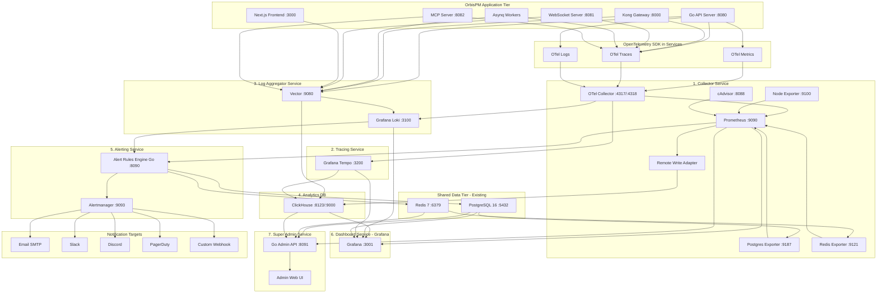
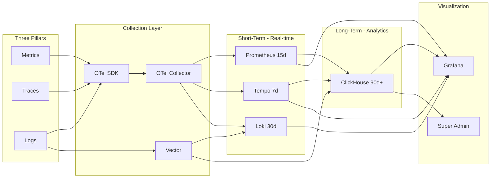
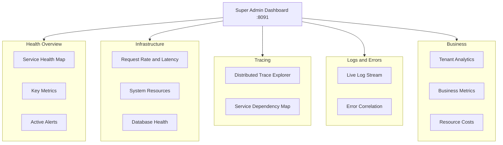
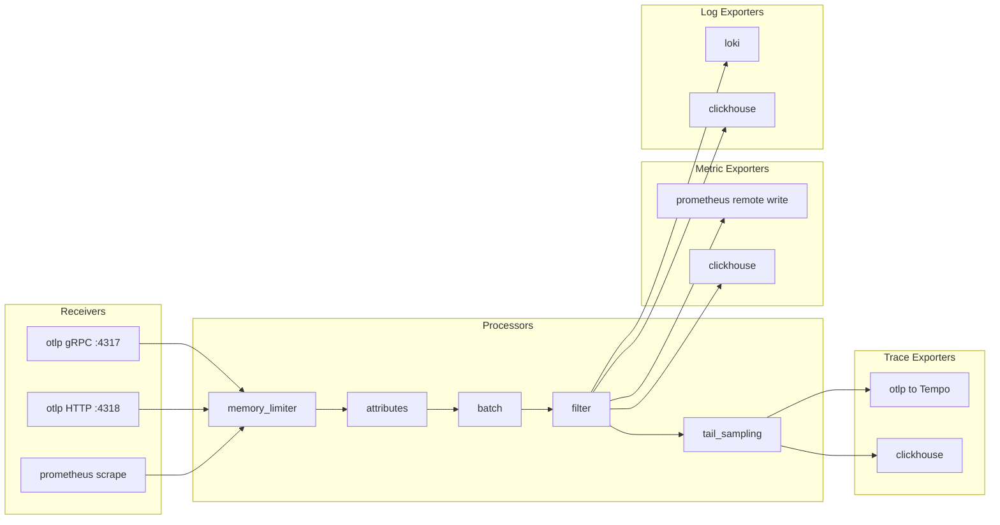
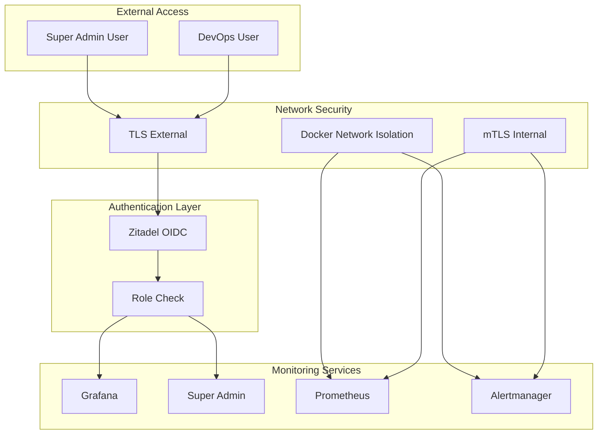

# OrbisPM Monitoring Architecture — Diagrams

> **Stack**: OpenTelemetry · Prometheus · Grafana · Loki · Tempo · ClickHouse  
> **Mermaid version**: 8.8.0 compatible

---

## 1. Complete Architecture

---

## 2. Data Flow - Three Signals

---

## 3. Super Admin Dashboard Panels

---

## 4. OTel Collector Pipeline

---

## 5. Security Architecture

---

## Service Ports

| Service | Port | Access |
|---------|------|--------|
| OTel Collector | 4317/4318 | Internal only |
| Prometheus | 9090 | Internal only |
| Tempo | 3200 | Internal only |
| Loki | 3100 | Internal only |
| Grafana | 3001 | Authenticated |
| ClickHouse | 8123 | Internal only |
| Super Admin | 8091 | Authenticated |
| Alert Engine | 8090 | Internal only |
| Alertmanager | 9093 | Internal only |
| Vector | 9080 | Internal only |
